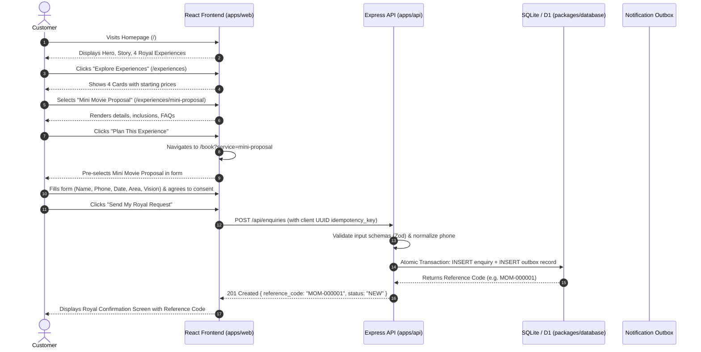
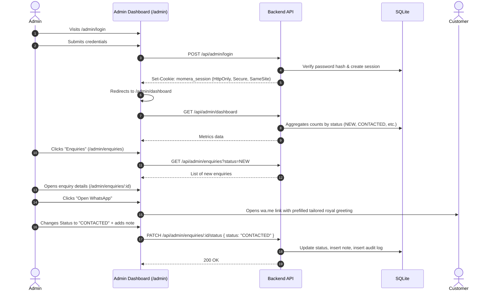
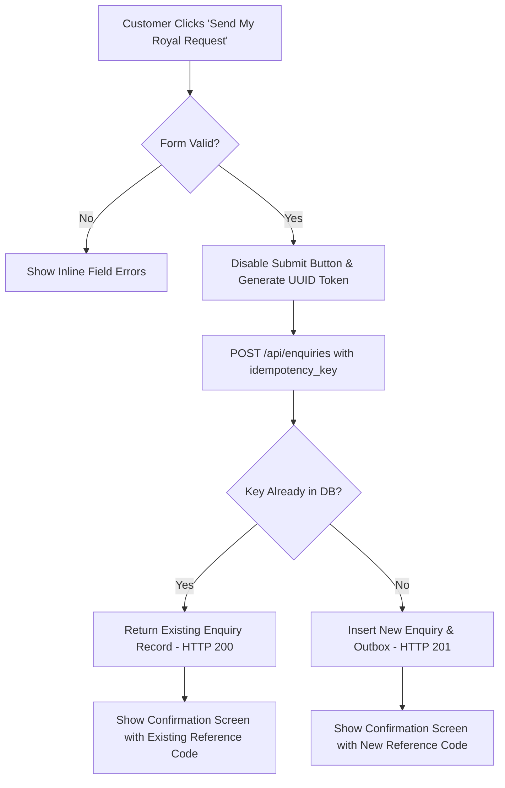

# MOMÉRA — User Flows & Interaction Journeys

This document outlines the end-to-end customer and administrative journeys through the MOMÉRA platform.

---

## 1. Flow 1: Customer Discovery to Enquiry Submission

---

## 2. Flow 2: Admin Concierge Management & WhatsApp Contact

---

## 3. Flow 3: Edge Case & Idempotency Handling

